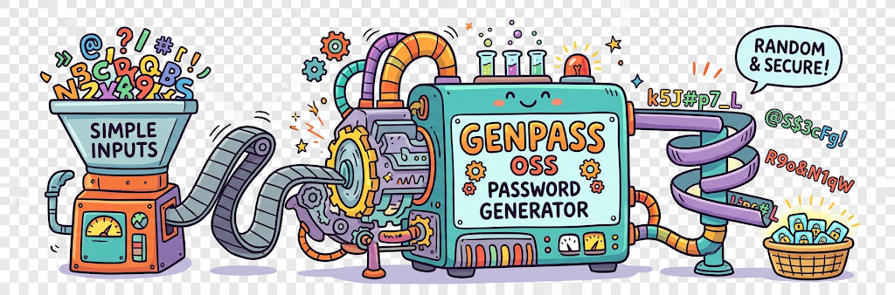

# GenPass




An enterprise-grade, cryptographically secure cross-platform token and passphrase generation utility engineered with zero-trace volatile clipboard handling and robust structural string validation mechanics.

## Table of Contents
1. [Core Features](#core-features)
2. [Installation Systems](#installation-systems)
3. [Algorithmic Architecture](#algorithmic-architecture)
4. [Command Line Usage Reference](#command-line-usage-reference)
5. [Development Ecosystem](#development-ecosystem)
6. [Platform Native Distribution Specs](#platform-native-distribution-specs)
7. [License Matrix](#license-matrix)

## Core Features
- **Deterministic Token Initialization:** Fine-tune string structure bounds by specifying initialization hooks (`alnum`, `alphabetic`, `numeric`, `symbolic`, or literal bounds).
- **Volatile Clipboard Scrubbing:** Zero-trace execution via automated thread memory buffer purging interfaces (`pyperclip` system abstractions).
- **Rigid Data Exclusions:** Dynamic runtime blacklist filters parsing character distributions across complex pipeline matrix constraints.

## Installation Systems
To assemble dependencies across production contexts, call the orchestration interface via `just`:
```bash
# Clone the repository
git clone https://github.com
cd genpass

# Invoke local automated environment linking pipeline
just install
```

## Algorithmic Architecture
GenPass leverages Python's `secrets` module primitives to ensure entropy properties meet criteria for system account seeding requirements. It avoids standard pseudorandom generation vectors, preserving protection against brute-force guessing patterns.

## Command Line Usage Reference
```bash
# Standard Execution
genpass -l 16 -s 4

# Zero-Trace Passphrase Clipboard Memory Allocation Mode
genpass --passphrase --words 6 --clip
```

## Development Ecosystem
Please refer to the complete system [CONTRIBUTING.md](CONTRIBUTING.md) guide for checking guidelines using `ruff` and `basedpyright` verification constraints.


## Platform Native Distribution Specs (`just package` Targets)
When you execute `just package`, the following configurations are generated or mapped in your build output space:
- **Scoop** (Windows): genpass.json app manifest mapping the build wheel to local user paths cleanly.
- **Homebrew** (macOS/Linux): genpass.rb formula script definition extracting binary entry scripts.
- **APT** (Debian): Standard .deb metadata package mapping control architectures inside an automated layout.
- **RPM** (RedHat): Spec compilation mapping system schemas to install smoothly on Enterprise Linux platforms.
- **AppImage**: Standalone binary compilation output generated by mapping package environments using an internal AppDir layout structure.

## License Matrix
Distributed strictly under the terms of the GNU General Public License v3.0. See [LICENSE](LICENSE) for explicit parameter legal manifestations.
